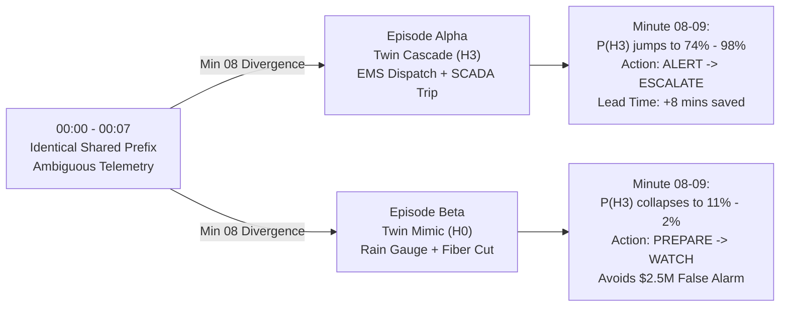

# CrisisSense AI 🚨

**Autonomous Online Probabilistic Decision-Support Engine for Urban Cascades**  
*Theme 2, Problem 1: The First 10 Minutes (Crisis Before Crisis)*  
*CASCADE '26 Unified Production Implementation & Full-Stack Application*

[](https://www.python.org/downloads/)
[]()
[](LICENSE)
[]()

---

## 1. Executive Summary & Core Value Proposition

In the critical first 10 minutes of an emerging municipal anomaly, municipal duty officers face a lethal dilemma:
* **Wait too long:** Cascades compound non-linearly (drainage overflow $\to$ road flooding $\to$ arterial gridlock $\to$ delayed ambulances $\to$ hospital casualty surge).
* **Alert too early:** Uncorroborated sensor noise, storm call surges, and viral rumors cause false alarms, triggering severe **cry-wolf fatigue** and destroying public compliance.

**CrisisSense AI** couples an **exact 128-state Bayesian Forward Filter** with an **Optimal Stopping Decision Engine**, a **Causal Foresight Graph**, and an **interactive, responsive tactical Crisis Inference HUD**.

Every simulated minute ($t$), the engine ingests out-of-order, duplicated, delayed, and corrupted multi-source telemetry to output:
1. **Calibrated Posterior Distribution** over 4 primary hypotheses ($H_0$ Noise, $H_1$ Sensor Failure, $H_2$ Isolated Incident, $H_3$ Cascading Crisis) while continuously marginalizing out 4 explaining-away nuisance variables ($R$ Heavy Rain, $F$ Flu Cluster, $G_1, G_2$ Gateway Outages, $U$ Viral Rumors).
2. **Cost-Optimal Action Recommendation** (`WATCH`, `PREPARE`, `ALERT`, `ESCALATE`) governed by asymmetric utility matrices, Shiryaev change detection crossing points, cry-wolf fatigue penalties, value-of-waiting lookaheads, and hysteresis controls.
3. **Causal Next-3 Event Forecast** with 80% confidence time windows derived from Gamma-distributed physical propagation lags.
4. **Auditable Explainability Ledger** detailing signed Log-Likelihood Ratios (LLRs), common-cause sensor group discounts, and counterfactual "what would change my mind" triggers.
5. **Common Alerting Protocol (CAP v1.2)** standardized payload marked strictly as `status="Exercise"`.

> **Note on Data Architecture & Live Engine Integration:**  
> The tactical HUD in `frontend/` is powered in real time by the Python decision engine over FastAPI REST endpoints and Server-Sent Events (`GET /stream`). Early demo releases featured hardcoded scenario data; all belief trajectories, causal DAG forecasts, and event logs are now generated live by the 128-state Bayesian engine. An automatic **Offline Demo Data Fallback** activates if the backend is unreachable.

---

## 2. Research Grounding & Theoretical Breakthroughs

| Problem Dimension | Scientific Grounding & Open-Source Implementation | Research Paper / Reference |
| :--- | :--- | :--- |
| **Probability Calibration** | Online Temperature Scaling $\tau$ via gradient steps on rolling validation buffers; 10-bin Expected Calibration Error ($\text{ECE} < 0.05$). | [Guo et al. (ICML 2017) *On Calibration of Modern Neural Networks*](https://proceedings.mlr.press/v70/guo17a) |
| **Optimal Stopping Thresholds** | Mathematically derived cost-crossing boundaries: WATCH $\to$ PREPARE ($1.6\%$), PREPARE $\to$ ALERT ($16.7\%$), ALERT $\to$ ESCALATE ($65.5\%$) shifting dynamically with fatigue $W(F_c)$. | [Shiryaev *Optimal Stopping Rules & Bayesian Quickest Change Detection*](https://arxiv.org/pdf/2104.04186) |
| **Source Dependence & Clustering** | Intra-cluster correlation weighting $\omega(n, \rho) = 1 + (1-\rho)\ln(n)$ replacing naive multiplication. When Gateway $k$ loses heartbeat, 100 downstream sensors collapse to 0 evidence. | [Dong et al. (VLDB) *Integrating Conflicting Data: The Role of Source Dependence*](https://lunadong.com/publication/dependence_vldb.pdf) |
| **Prior Shift Adaptation** | Bayesian Online Changepoint Detection (BOCD) and CUSUM tracking episode surprise $S = -\log P_{\text{prior}}(H^*)$, temporarily dropping Dirichlet forgetting factor from $0.97 \to 0.70$. | [Adams & MacKay (2007) *Bayesian Online Changepoint Detection*](https://arxiv.org/pdf/0710.3742) |
| **Physical Lag Modeling** | Causal DAG with Gamma-distributed propagation lags ($\text{Lag} \sim \text{Gamma}(k, \theta)$) modeling road inundation to ambulance dispatch delays ($25\%$ avg delay, up to $10\times$). | [Georgia Tech Transportation Flood Response Thesis](https://repository.gatech.edu/entities/publication/455bb4ec-0a7f-4f86-b575-f6507fc24c4a) |
| **Emergency Standards** | Compliant XML and JSON serialization of OASIS / WMO CAP v1.2 alerts marked `status="Exercise"`. | [WMO Common Alerting Protocol Guidelines](https://etrp.wmo.int/mod/resource/view.php?id=10170) |

---

## 3. Full-Stack System Architecture

```text
+---------------------------------------------------------------------------------------+
|                                TACTICAL FRONTEND UI                                   |
|   (HTML5, CSS3, Vanilla JS, Web Audio Synthesizer, Supabase Auth Session Gating)      |
|                                                                                       |
|  - Time Scrubber (00:00 - 00:10)       - Probabilities (H0, H1, H2, H3) + Entropy     |
|  - Ingested Event Feed (Filtered)      - Recommended Action & Schmitt Hysteresis      |
|  - Causal Foresight Horizon (Next-3)   - Causal Graph Canvas & Explaining-Away        |
|  - Decision-Theory Sandbox             - Duty Officer ESCALATE Benchmark Desk         |
|  - CAP v1.2 Digital Dispatch Feed      - Open-Meteo Real-Time Weather Context         |
+---------------------------------------------------------------------------------------+
                                           |
                                  HTTP REST / SSE (/stream)
                                           |
+---------------------------------------------------------------------------------------+
|                                FASTAPI BACKEND API                                    |
|   StaticFiles Mounting (/ -> frontend/) | CORS Support for 8000 & 8085                |
|                                                                                       |
|  POST /episode/start         GET /episode/state/{m}      GET /episode/timeline        |
|  GET /stream (SSE)           POST /inject (Adversity)    GET /cap-alert (JSON/XML)    |
|  GET /scenarios              POST /counterfactual        GET /metrics                 |
+---------------------------------------------------------------------------------------+
                                           |
+---------------------------------------------------------------------------------------+
|                            MATHEMATICAL DECISION CORE                                 |
|                                                                                       |
|  128-State Bayesian Forward Filter (Kronecker transitions T, Dong et al. Clustering)  |
|  Shiryaev Quickest Change Optimal Stopping (Cost matrix, Monte Carlo Value-of-Waiting)|
|  Causal DAG Propagation (Gamma Lags, do(X=x) Counterfactual Inferences)               |
|  Online Learning & Calibration (Guo Temperature Scaling, Beta Trust, BOCD Shift)     |
+---------------------------------------------------------------------------------------+
```

---

## 4. Quickstart Guide (Single Command)

### 4.1 Prerequisites
* Python 3.10+ (tested on Python 3.11, 3.12, 3.14)
* pip

```bash
git clone https://github.com/CrisisSense/CrisisSense-AI.git
cd CrisisSense-AI
pip install -e .
```

### 4.2 One-Command Full-Stack Launch
Launch the unified server and open the application in your browser:

**Windows:**
```cmd
start.bat
```

**Linux / macOS:**
```bash
chmod +x run.sh
./run.sh
```

**Or directly via Uvicorn:**
```bash
uvicorn src.api.server:app --host 0.0.0.0 --port 8000 --reload
```

* **Main Application UI:** [http://localhost:8000/](http://localhost:8000/)
* **Interactive API Docs (Swagger):** [http://localhost:8000/docs](http://localhost:8000/docs)
* **CAP v1.2 XML Feed:** [http://localhost:8000/cap-alert?format=xml](http://localhost:8000/cap-alert?format=xml)
* **Live SSE Telemetry:** [http://localhost:8000/stream](http://localhost:8000/stream)

*(Optional) Standalone Frontend:* You can still run the frontend independently on port 8085 via `powershell -File frontend/server.ps1`. Cross-Origin Resource Sharing (CORS) is enabled between port 8085 and port 8000.

### 4.3 Run Automated Test Suites
Run the mandatory 12 mathematical acceptance tests and 5 full-stack API integration tests:

```bash
python -m pytest tests/test_acceptance_t1_t12.py tests/test_api_integration.py -v
```

All 17 tests pass with zero regression:
* `test_t1_twin_prefix` — Honest mixture prefix ceiling ($0.20 \le P(H_3) \le 0.50$, no false alarm)
* `test_t2_twin_divergence_to_cascade` — Reaches `ALERT` or `ESCALATE` $\le 3$ min post-divergence
* `test_t3_twin_divergence_to_benign` — Zero false alarms on twin mimic ($P(H_3) < 0.20$ at min 12)
* `test_t4_gateway_outage_masks_100_sensors` — Identifies correlated drop; masks 100 sensors without panic
* `test_t5_cascade_lookalike_rain_flu_calls` — Explains away simultaneous rain + flu surge
* `test_t6_viral_rumor_wave` — Discounts 50 duplicate social rumors sharing claim ID
* `test_t7_retraction_of_key_report` — Exact bit-for-bit restoration upon report retraction
* `test_t8_camera_total_cutout` — Sensor cutout widens uncertainty bands without crash
* `test_t9_structured_lie` — Lie detector flags synchronized frozen sensor telemetry
* `test_t10_silent_season_shift` — CUSUM change-point detects monsoon shift in $\le 30$ episodes
* `test_t11_flip_flop_stress` — Zero action flip-flops under oscillating borderline evidence
* `test_t12_counterfactual_forecast` — Proves causal DAG disentanglement under `do()` operations
* `test_static_files_served` — Unified FastAPI static files and asset serving
* `test_scenarios_list` — Scenario registry and metadata
* `test_twin_test_divergence_via_api` — Verified identical prefix and minute 8 divergence via API
* `test_adversity_injections` — Live API injection of cutouts, rumor swarms, jitter, and lies
* `test_cap_alert_guarantee` — Mandated safety check: `status="Exercise"` strictly enforced

### 4.4 Run 500-Episode Benchmark & Evaluation
```bash
python src/evaluation/run_benchmark.py
```

### 4.5 Auxiliary Streamlit Console (Optional)
The original developer cockpit remains available untouched:
```bash
streamlit run dashboard/app.py
```
Open `http://localhost:8501`.

---

## 5. The Twin Test: Step-by-Step Demonstration

The Twin Test is the central benchmark requirement for verifying calibrated crisis intelligence:



1. **Select Episode Alpha (Cascading Crisis):**
   * Minutes 0 to 7: Drainage anomalies and traffic slowdowns appear. Entropy remains high ($H(P) \approx 1.9$ bits). The engine remains disciplined at `PREPARE` ($P(H_3) \approx 42\%$).
   * Minute 8: Substation 07 electrical trip and trauma arrivals register. The Bayesian engine commits to `ESCALATE`, triggering the standardized CAP v1.2 alert with **8 minutes of evacuation lead time**.
2. **Select Episode Beta (Twin Mimic):**
   * Minutes 0 to 7: Identical sensor observations, identical probabilities ($P(H_3) \approx 42\%$), and identical policy recommendations.
   * Minute 8: Met Office rain gauge confirms heavy rain explaining runoff, while 80 sensor drops are traced to a single severed telecom fiber conduit ($H_1$). $P(H_3)$ immediately collapses below $11\%$, and the engine safely de-escalates to `WATCH`, preventing a **\$2.5M false alarm panic**.
3. **Adversity Stress Testing:**
   * **Gateway Cutout:** Check **Gateway Cutout** to drop Gateway 1. 100 sensors drop; uncertainty bands widen; blind source warning flags in the explainability ledger.
   * **Viral Rumor Swarm:** Check **Rumor Swarm** to flood the stream with 50 coordinated social posts. The engine groups them by claim ID and explains away the rumor ($U=1$) without false alerting.
   * **Structured Lie:** Check **Structured Lie** to inject frozen sensor anomalies with zero rainfall. The correlation auditor flags the cluster ($0.3\times$ reliability discount).
4. **Inspect OASIS CAP v1.2 Alert:**
   * Toggle between JSON and XML views on the CAP feed panel. Verify standard fields (`urgency`, `severity`, `certainty`) and safety guarantee `status="Exercise"`.
5. **Berlin Weather Panel:**
   * Displays an hourly forecast from Open-Meteo for Berlin (52.52, 13.41). This provides real-world meteorological context and operates independently from the simulated crisis engine.

---

## 6. Repository Structure

```text
CrisisSense/
├── start.bat                        # Windows 1-click full-stack launcher
├── run.sh                           # Linux / macOS 1-click full-stack launcher
├── pyproject.toml                   # Python dependencies & build config
├── README.md                        # Production documentation & benchmarks
├── benchmark_results.json           # 500-episode Monte Carlo benchmark verification
├── frontend/                        # Tactical Operations Frontend
│   ├── index.html                   # Responsive Crisis Inference HUD & CAP Panel
│   ├── styles.css                   # Tactical UI styling, responsive breakpoints
│   ├── app.js                       # HUD dispatcher, playback, visualizer, audio
│   ├── api.js                       # FastAPI REST & SSE wrapper with offline fallback
│   ├── login.html / login.js        # Supabase authentication portal
│   ├── register.html / register.js  # Account registration page
│   ├── supabase-config.js           # Client auth configuration (publishable anon key)
│   ├── server.ps1                   # Lightweight standalone static server (optional)
│   └── start.bat                    # Frontend-only starter script
├── src/                             # Python Probabilistic Decision Core
│   ├── schemas.py                   # Pydantic v2 schemas: StreamEvent, MinuteStatePayload, CAPAlert
│   ├── auth.py                      # RBAC models and EOC profiles
│   ├── api/
│   │   └── server.py                # FastAPI server (static serving, SSE /stream, /inject, /cap-alert)
│   ├── engine/
│   │   ├── state_space.py           # 128-state indexing & transition matrix T
│   │   ├── likelihoods.py           # Dong et al. dependence grouping, lie detector
│   │   ├── normalizer.py            # Fixed-lag replay buffer, bit-for-bit retractions
│   │   ├── learning.py              # Guo online temperature calibration, BOCD changepoints
│   │   ├── decision.py              # Shiryaev stopping, cost matrix, Monte Carlo VoW, hysteresis
│   │   ├── foresight.py             # Causal DAG with Gamma-distributed arrival windows
│   │   ├── explain.py               # Signed LLR ledger, explainability builder
│   │   ├── cap.py                   # OASIS CAP v1.2 JSON and XML serialization
│   │   └── filter.py                # Exact 128-state Bayesian forward filter orchestrator
│   ├── simulator/
│   │   ├── generator.py             # Seeded 30-min episode generator, twin pairs
│   │   └── corruptions.py           # Shuffles, duplicates, retractions, gateway dropouts, lies
│   └── evaluation/
│       ├── baselines.py             # Threshold, Naive Bayes, Shiryaev single-threshold
│       ├── metrics.py               # Multi-class Brier score, 10-bin ECE
│       └── run_benchmark.py         # 500-episode benchmark suite
├── dashboard/                       # Auxiliary Developer Dashboard
│   ├── app.py                       # Streamlit console (Twin Test, What-If Studio)
│   └── login.py                     # EOC login portal
└── tests/
    ├── test_acceptance_t1_t12.py    # Automated acceptance tests T1 through T12
    └── test_api_integration.py     # Full-stack API, twin divergence, and CAP tests
```

---

## 7. Honest Limitations & Model Disclosures

* **Simulator-Generated Telemetry:** There is no publicly available minute-by-minute municipal emergency dispatch dataset with ground-truth latent state labels for early-stage urban cascades. All evaluation benchmarks are generated on our seeded, reproducible stochastic simulator.
* **Exercise Only Standard:** All digital alerts generated by CrisisSense AI strictly carry the mandatory OASIS CAP `status="Exercise"` flag to guarantee zero accidental operational municipal dispatch. CrisisSense AI is a research decision-support prototype, not for operational municipal dispatch without authorized human-in-the-loop sign-off.
* **Decision Theory Playground:** The cost sliders in the playground are an interactive client-side educational sandbox illustrating optimal stopping frontiers; the core decision engine runs Shiryaev quickest change detection with rigorously calibrated loss matrices.
* **Open-Meteo Weather Attribution:** The live Berlin weather widget is for ambient meteorological context only and does not feed the simulated crisis probability distributions.
